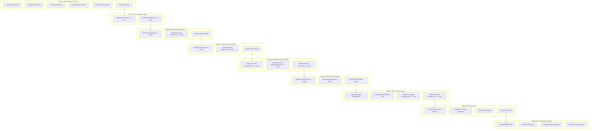
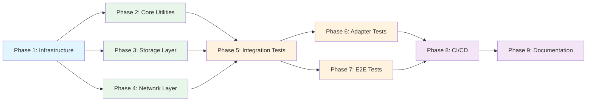
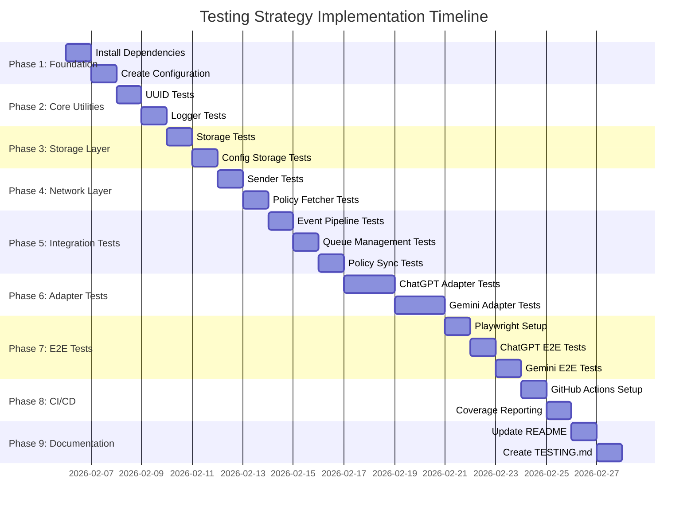

# Work Plan: Testing Strategy Implementation

## Document Metadata
- **Created**: 2026-02-05
- **Type**: testing-implementation
- **Status**: Ready for Execution
- **Estimated Duration**: 15-18 days
- **Design Document**: docs/design/testing-strategy.md
- **Test Skeletons**: 20 files (113 test cases)
- **Target Coverage**: 80-85% overall

## Executive Summary

Implement comprehensive testing infrastructure for PromptLineAI Chrome Extension from zero to 80%+ code coverage. This plan follows the 9-phase vertical slice approach defined in the design document, with 113 test cases already created as skeletons across unit, integration, adapter, and E2E test categories.

### Key Objectives
1. Establish Vitest-based test infrastructure
2. Achieve 80-85% overall code coverage
3. Implement 113 test cases across 4 categories
4. Setup CI/CD automated testing pipeline
5. Create comprehensive testing documentation

### Implementation Strategy
**Vertical Slice (Feature-driven)**: Each phase delivers independently verifiable test capabilities, allowing parallel development and early value delivery.

## TodoWrite Registration

- [x] Confirm skill constraints
- [ ] Phase 1: Foundation - Test Infrastructure Setup
- [ ] Phase 2: Unit Tests - Core Utilities
- [ ] Phase 3: Unit Tests - Storage Layer
- [ ] Phase 4: Unit Tests - Network Layer
- [ ] Phase 5: Integration Tests - Event Pipeline
- [ ] Phase 6: Adapter Tests - DOM Detection
- [ ] Phase 7: E2E Tests - Full Workflows
- [ ] Phase 8: CI/CD Integration
- [ ] Phase 9: Documentation
- [ ] Verify skill fidelity

## Phase Structure Diagram



## Task Dependency Diagram



## Phase 1: Foundation - Test Infrastructure Setup

**Duration**: 1-2 days
**Verification Level**: L3 (Build success) - `pnpm test` runs without errors

### Tasks

#### 1.1 Install Testing Dependencies and Configure Package.json
**Completion Criteria**: Dependencies installed, package.json scripts added, smoke test passes

**Steps**:
- [ ] Install Vitest framework: `pnpm add -D vitest@^2.1.0`
- [ ] Install Chrome API mocking: `pnpm add -D vitest-chrome@^1.0.0`
- [ ] Install DOM environment: `pnpm add -D happy-dom@^15.0.0`
- [ ] Install coverage tooling: `pnpm add -D @vitest/coverage-v8@^2.1.0`
- [ ] Install E2E framework: `pnpm add -D playwright@^1.50.0`
- [ ] Add test scripts to package.json:
  ```json
  {
    "scripts": {
      "test": "vitest run",
      "test:watch": "vitest",
      "test:unit": "vitest run tests/unit",
      "test:integration": "vitest run tests/integration",
      "test:adapters": "vitest run tests/adapters",
      "test:e2e": "playwright test",
      "test:coverage": "vitest run --coverage",
      "coverage:view": "open coverage/index.html"
    }
  }
  ```

**Verification**: `pnpm test` command runs (even if no tests exist yet)

**AC Traceability**: AC-1 (Test Framework Setup)

#### 1.2 Create Vitest Configuration
**Completion Criteria**: vitest.config.ts created with correct settings, configuration validated

**Steps**:
- [ ] Create `vitest.config.ts` in project root
- [ ] Configure happy-dom environment
- [ ] Set coverage thresholds (80% lines, 75% branches)
- [ ] Configure test exclusions (env.generated.ts, popup.ts, options.ts)
- [ ] Set global test timeout and retry settings
- [ ] Reference existing skeleton file: `tests/vitest.config.ts`

**Verification**: Vitest loads configuration without errors

**AC Traceability**: AC-1 (Test Framework Setup)

#### 1.3 Create Global Test Setup
**Completion Criteria**: tests/setup.ts created, chrome API mocks initialized

**Steps**:
- [ ] Create `tests/setup.ts`
- [ ] Import and configure vitest-chrome
- [ ] Setup global chrome API mock
- [ ] Add beforeEach hook to reset mocks
- [ ] Verify chrome API available in tests

**Verification**: Chrome API mocks accessible in test environment

**AC Traceability**: AC-1 (Test Framework Setup)

#### 1.4 Create Fixture and Helper Directories
**Completion Criteria**: Fixture and helper infrastructure created, documented

**Steps**:
- [ ] Create `tests/fixtures/` directory
- [ ] Create `tests/helpers/` directory
- [ ] Create basic fixture files:
  - [ ] `tests/fixtures/events.ts` - Mock event data factory functions
  - [ ] `tests/fixtures/policies.ts` - Mock policy configurations
  - [ ] `tests/fixtures/dom-templates.ts` - HTML templates for adapter testing
- [ ] Create helper files:
  - [ ] `tests/helpers/chrome-api.ts` - Chrome API mock helpers
  - [ ] `tests/helpers/dom-setup.ts` - DOM environment setup utilities

**Verification**: Fixture and helper files import successfully

**AC Traceability**: AC-1 (Test Framework Setup)

#### 1.5 Create and Run Smoke Test
**Completion Criteria**: Simple smoke test passes, test runner verified working

**Steps**:
- [ ] Create `tests/smoke.test.ts` with basic test
- [ ] Run `pnpm test` - verify test passes
- [ ] Run `pnpm test:watch` - verify watch mode works
- [ ] Verify test output formatting
- [ ] Delete smoke test after verification

**Verification**: Test runner executes successfully, tests complete in < 5 seconds

**AC Traceability**: AC-1 (Test Framework Setup)

**Dependencies**: None - Foundation phase

---

## Phase 2: Unit Tests - Core Utilities

**Duration**: 1 day
**Verification Level**: L2 (Tests pass) - All utility tests pass, 100% coverage achieved

### Tasks

#### 2.1 Implement UUID Utility Tests (4 tests)
**Completion Criteria**: 4 test cases implemented and passing, 100% coverage achieved

**Reference**: `tests/unit/lib/uuid.test.ts` (skeleton already created)

**Test Cases**:
- [ ] Test 1: should generate a valid UUID v4 format string
  - **@category**: core-functionality
  - **@dependency**: none
  - **@complexity**: low
  - **Expected**: UUID matches regex `/^[0-9a-f]{8}-[0-9a-f]{4}-4[0-9a-f]{3}-[89ab][0-9a-f]{3}-[0-9a-f]{12}$/i`

- [ ] Test 2: should generate unique UUIDs on multiple calls
  - **@category**: core-functionality
  - **@dependency**: none
  - **@complexity**: low
  - **Expected**: 3 generated UUIDs are all different

- [ ] Test 3: should return a string type
  - **@category**: core-functionality
  - **@dependency**: none
  - **@complexity**: low
  - **Expected**: `typeof uuid === 'string'`

- [ ] Test 4: should return a non-empty string
  - **@category**: core-functionality
  - **@dependency**: none
  - **@complexity**: low
  - **Expected**: UUID length > 0

**Verification**: `pnpm test:unit tests/unit/lib/uuid.test.ts` passes with 100% coverage

**AC Traceability**: AC-2 (Unit Tests - Core Utilities)

#### 2.2 Implement Logger Utility Tests (4 tests)
**Completion Criteria**: 4 test cases implemented and passing, 100% coverage achieved

**Reference**: `tests/unit/lib/logger.test.ts` (skeleton already created)

**Test Cases**:
- [ ] Test 1: should log messages at different levels
  - **@category**: core-functionality
  - **@dependency**: console API
  - **@complexity**: low
  - **Expected**: console.log/warn/error called appropriately

- [ ] Test 2: should include context in log messages
  - **@category**: core-functionality
  - **@dependency**: console API
  - **@complexity**: low
  - **Expected**: Context string included in output

- [ ] Test 3: should handle structured data logging
  - **@category**: core-functionality
  - **@dependency**: console API
  - **@complexity**: low
  - **Expected**: Objects logged correctly

- [ ] Test 4: should not throw on null/undefined values
  - **@category**: edge-case
  - **@dependency**: console API
  - **@complexity**: low
  - **Expected**: No errors when logging null/undefined

**Verification**: `pnpm test:unit tests/unit/lib/logger.test.ts` passes with 100% coverage

**AC Traceability**: AC-2 (Unit Tests - Core Utilities)

**Dependencies**: Phase 1 complete

---

## Phase 3: Unit Tests - Storage Layer

**Duration**: 2 days
**Verification Level**: L2 (Tests pass) - All storage tests pass, 90%+ coverage achieved

### Test Case Resolution: 17 tests total

### Tasks

#### 3.1 Implement Event Queue Storage Tests (8 tests)
**Completion Criteria**: 8 test cases implemented and passing, 100% coverage achieved

**Reference**: `tests/unit/storage.test.ts` (skeleton already created)

**Test Cases** (8 total):
- [ ] Test 1: should queue a single event to chrome.storage.local
  - **@category**: core-functionality | **@dependency**: chrome.storage.local | **@complexity**: medium

- [ ] Test 2: should append multiple events to the queue
  - **@category**: core-functionality | **@dependency**: chrome.storage.local | **@complexity**: medium

- [ ] Test 3: should retrieve all queued events
  - **@category**: core-functionality | **@dependency**: chrome.storage.local | **@complexity**: low

- [ ] Test 4: should return empty array when no events queued
  - **@category**: edge-case | **@dependency**: chrome.storage.local | **@complexity**: low

- [ ] Test 5: should remove specified events from the queue
  - **@category**: core-functionality | **@dependency**: chrome.storage.local | **@complexity**: medium

- [ ] Test 6: should clear entire event queue
  - **@category**: core-functionality | **@dependency**: chrome.storage.local | **@complexity**: low

- [ ] Test 7: should handle chrome.storage errors gracefully
  - **@category**: edge-case | **@dependency**: chrome.storage.local | **@complexity**: medium

- [ ] Test 8: should invalidate cache when queue is modified
  - **@category**: core-functionality | **@dependency**: chrome.storage.local | **@complexity**: medium

**Verification**: `pnpm test:unit tests/unit/storage.test.ts` passes with 100% coverage

**AC Traceability**: AC-3 (Unit Tests - Storage Layer)

#### 3.2 Implement Config Storage Tests (9 tests)
**Completion Criteria**: 9 test cases implemented and passing, 90%+ coverage achieved

**Reference**: `tests/unit/config-storage.test.ts` (skeleton already created)

**Test Cases** (9 total):
- [ ] Test 1: should store and retrieve device_id
  - **@category**: core-functionality | **@dependency**: chrome.storage.local | **@complexity**: low

- [ ] Test 2: should persist policy configuration
  - **@category**: core-functionality | **@dependency**: chrome.storage.local | **@complexity**: medium

- [ ] Test 3: should cache policy to avoid redundant reads
  - **@category**: core-functionality | **@dependency**: chrome.storage.local | **@complexity**: medium

- [ ] Test 4: should update policy timestamp
  - **@category**: core-functionality | **@dependency**: chrome.storage.local | **@complexity**: low

- [ ] Test 5: should return default policy if none exists
  - **@category**: edge-case | **@dependency**: chrome.storage.local | **@complexity**: low

- [ ] Test 6: should handle corrupted policy data
  - **@category**: edge-case | **@dependency**: chrome.storage.local | **@complexity**: medium

- [ ] Test 7: should store DRY_RUN flag
  - **@category**: core-functionality | **@dependency**: chrome.storage.local | **@complexity**: low

- [ ] Test 8: should clear all configuration
  - **@category**: core-functionality | **@dependency**: chrome.storage.local | **@complexity**: low

- [ ] Test 9: should handle storage quota exceeded
  - **@category**: edge-case | **@dependency**: chrome.storage.local | **@complexity**: medium

**Verification**: `pnpm test:unit tests/unit/config-storage.test.ts` passes with 90%+ coverage

**AC Traceability**: AC-3 (Unit Tests - Storage Layer)

**Dependencies**: Phase 1 complete

---

## Phase 4: Unit Tests - Network Layer

**Duration**: 2 days
**Verification Level**: L2 (Tests pass) - All network tests pass, 85%+ coverage achieved

### Test Case Resolution: 18 tests total

### Tasks

#### 4.1 Implement HTTP Sender Tests (10 tests)
**Completion Criteria**: 10 test cases implemented and passing, 85%+ coverage achieved

**Reference**: `tests/unit/sender.test.ts` (skeleton already created)

**Test Cases** (10 total):
- [ ] Test 1: should successfully send events to backend
  - **@category**: core-functionality | **@dependency**: fetch API | **@complexity**: medium

- [ ] Test 2: should include auth token in request headers
  - **@category**: core-functionality | **@dependency**: clerk-auth | **@complexity**: medium

- [ ] Test 3: should batch multiple events in single request
  - **@category**: core-functionality | **@dependency**: fetch API | **@complexity**: medium

- [ ] Test 4: should retry on transient errors (500, 502, 503)
  - **@category**: core-functionality | **@dependency**: fetch API, timers | **@complexity**: high

- [ ] Test 5: should NOT retry on client errors (400, 401, 403)
  - **@category**: core-functionality | **@dependency**: fetch API | **@complexity**: medium

- [ ] Test 6: should handle rate limiting (429) with exponential backoff
  - **@category**: core-functionality | **@dependency**: fetch API, timers | **@complexity**: high

- [ ] Test 7: should timeout after configured duration
  - **@category**: edge-case | **@dependency**: fetch API, timers | **@complexity**: medium

- [ ] Test 8: should handle network errors gracefully
  - **@category**: edge-case | **@dependency**: fetch API | **@complexity**: medium

- [ ] Test 9: should respect DRY_RUN mode (no actual requests)
  - **@category**: core-functionality | **@dependency**: none | **@complexity**: low

- [ ] Test 10: should handle 409 conflict errors
  - **@category**: edge-case | **@dependency**: fetch API | **@complexity**: medium

**Verification**: `pnpm test:unit tests/unit/sender.test.ts` passes with 85%+ coverage

**AC Traceability**: AC-4 (Unit Tests - Network Layer)

#### 4.2 Implement Policy Fetcher Tests (8 tests)
**Completion Criteria**: 8 test cases implemented and passing, 85%+ coverage achieved

**Reference**: `tests/unit/policy-fetcher.test.ts` (skeleton already created)

**Test Cases** (8 total):
- [ ] Test 1: should fetch policy from API on startup
  - **@category**: core-functionality | **@dependency**: fetch API | **@complexity**: medium

- [ ] Test 2: should cache fetched policy to chrome.storage
  - **@category**: core-functionality | **@dependency**: fetch API, chrome.storage | **@complexity**: medium

- [ ] Test 3: should poll for policy updates at interval
  - **@category**: core-functionality | **@dependency**: fetch API, timers | **@complexity**: high

- [ ] Test 4: should use cached policy if fetch fails
  - **@category**: core-functionality | **@dependency**: chrome.storage | **@complexity**: medium

- [ ] Test 5: should update policy timestamp on successful fetch
  - **@category**: core-functionality | **@dependency**: chrome.storage | **@complexity**: low

- [ ] Test 6: should handle 401 unauthorized errors
  - **@category**: edge-case | **@dependency**: fetch API | **@complexity**: medium

- [ ] Test 7: should handle malformed policy response
  - **@category**: edge-case | **@dependency**: fetch API | **@complexity**: medium

- [ ] Test 8: should cancel polling on service worker shutdown
  - **@category**: core-functionality | **@dependency**: timers | **@complexity**: medium

**Verification**: `pnpm test:unit tests/unit/policy-fetcher.test.ts` passes with 85%+ coverage

**AC Traceability**: AC-4 (Unit Tests - Network Layer)

**Dependencies**: Phase 1 complete

---

## Phase 5: Integration Tests - Event Pipeline

**Duration**: 3 days
**Verification Level**: L2 (Tests pass) - All integration tests pass

### Test Case Resolution: 18 tests total

### Tasks

#### 5.1 Implement Event Pipeline Integration Tests (7 tests)
**Completion Criteria**: 7 test cases implemented and passing, full pipeline verified

**Reference**: `tests/integration/event-pipeline.test.ts` (skeleton already created)

**Test Cases** (7 total):
- [ ] Test 1: should complete full event pipeline from content script to backend
  - **@category**: integration | **@dependency**: content.ts, background.ts, storage.ts, sender.ts | **@complexity**: high

- [ ] Test 2: should remove events from queue after successful send
  - **@category**: integration | **@dependency**: storage.ts, sender.ts | **@complexity**: high

- [ ] Test 3: should re-queue events when send fails
  - **@category**: integration | **@dependency**: storage.ts, sender.ts | **@complexity**: high

- [ ] Test 4: should enforce policy and block events for disabled tools
  - **@category**: integration | **@dependency**: background.ts, policy-fetcher.ts, storage.ts | **@complexity**: medium

- [ ] Test 5: should handle message passing between content and background scripts
  - **@category**: integration | **@dependency**: chrome.runtime messaging | **@complexity**: medium

- [ ] Test 6: should batch multiple events in single flush
  - **@category**: integration | **@dependency**: storage.ts, sender.ts | **@complexity**: high

- [ ] Test 7: should handle background script errors without crashing
  - **@category**: edge-case | **@dependency**: background.ts, error-handling | **@complexity**: medium

**Verification**: `pnpm test:integration tests/integration/event-pipeline.test.ts` passes

**AC Traceability**: AC-5 (Integration Tests - Event Pipeline)

#### 5.2 Implement Queue Management Integration Tests (5 tests)
**Completion Criteria**: 5 test cases implemented and passing, queue limits verified

**Reference**: `tests/integration/queue-management.test.ts` (skeleton already created)

**Test Cases** (5 total):
- [ ] Test 1: should enforce MAX_QUEUE_SIZE and drop oldest events
  - **@category**: integration | **@dependency**: storage.ts | **@complexity**: high

- [ ] Test 2: should enforce BATCH_SIZE limit on flush
  - **@category**: integration | **@dependency**: storage.ts, sender.ts | **@complexity**: medium

- [ ] Test 3: should persist queue across service worker restarts
  - **@category**: integration | **@dependency**: chrome.storage.local | **@complexity**: high

- [ ] Test 4: should prevent concurrent flush operations (lock mechanism)
  - **@category**: integration | **@dependency**: storage.ts | **@complexity**: high

- [ ] Test 5: should keep events in queue in DRY_RUN mode
  - **@category**: integration | **@dependency**: storage.ts, sender.ts | **@complexity**: medium

**Verification**: `pnpm test:integration tests/integration/queue-management.test.ts` passes

**AC Traceability**: AC-6 (Integration Tests - Queue Management)

#### 5.3 Implement Policy Synchronization Integration Tests (6 tests)
**Completion Criteria**: 6 test cases implemented and passing, policy sync verified

**Reference**: `tests/integration/policy-sync.test.ts` (skeleton already created)

**Test Cases** (6 total):
- [ ] Test 1: should fetch policy on background script startup
  - **@category**: integration | **@dependency**: policy-fetcher.ts, chrome.storage | **@complexity**: medium

- [ ] Test 2: should cache policy to chrome.storage after fetch
  - **@category**: integration | **@dependency**: policy-fetcher.ts, chrome.storage | **@complexity**: medium

- [ ] Test 3: should poll for policy updates at configured interval
  - **@category**: integration | **@dependency**: policy-fetcher.ts, timers | **@complexity**: high

- [ ] Test 4: should use cached policy if API fetch fails
  - **@category**: integration | **@dependency**: policy-fetcher.ts, chrome.storage | **@complexity**: medium

- [ ] Test 5: should update policy timestamp on successful fetch
  - **@category**: integration | **@dependency**: policy-fetcher.ts, chrome.storage | **@complexity**: low

- [ ] Test 6: should stop polling when service worker shuts down
  - **@category**: integration | **@dependency**: policy-fetcher.ts, timers | **@complexity**: medium

**Verification**: `pnpm test:integration` passes all integration tests

**AC Traceability**: AC-7 (Integration Tests - Policy Synchronization)

**Dependencies**: Phases 2-4 complete

---

## Phase 6: Adapter Tests - DOM Detection

**Duration**: 3 days
**Verification Level**: L2 (Tests pass) - All adapter tests pass, 75%+ coverage achieved

### Test Case Resolution: 38 tests total

### Tasks

#### 6.1 Implement ChatGPT Adapter Tests (19 tests)
**Completion Criteria**: 19 test cases implemented and passing, 75%+ coverage achieved

**Reference**: `tests/adapters/chatgpt.test.ts` (skeleton already created)

**Test Groups**:

**DOM Element Detection (3 tests)**:
- [ ] Test 1: should detect ChatGPT textarea element on page load
  - **@category**: core-functionality | **@dependency**: DOM, MutationObserver | **@complexity**: medium

- [ ] Test 2: should detect contenteditable div as prompt input
  - **@category**: core-functionality | **@dependency**: DOM | **@complexity**: medium

- [ ] Test 3: should detect send button element
  - **@category**: core-functionality | **@dependency**: DOM | **@complexity**: low

**Event Emission (4 tests)**:
- [ ] Test 4: should emit prompt_submit event on Enter key press
  - **@category**: core-functionality | **@dependency**: DOM, chrome.runtime.sendMessage | **@complexity**: high

- [ ] Test 5: should emit prompt_submit event on send button click
  - **@category**: core-functionality | **@dependency**: DOM, chrome.runtime.sendMessage | **@complexity**: high

- [ ] Test 6: should emit file_selected event on file upload
  - **@category**: core-functionality | **@dependency**: DOM, chrome.runtime.sendMessage | **@complexity**: medium

- [ ] Test 7: should NOT emit duplicate events on rapid Enter presses
  - **@category**: edge-case | **@dependency**: DOM, debouncing | **@complexity**: medium

**Metadata Collection (5 tests)**:
- [ ] Test 8: should collect prompt length metadata
  - **@category**: core-functionality | **@dependency**: DOM | **@complexity**: low

- [ ] Test 9: should detect code blocks in prompt
  - **@category**: core-functionality | **@dependency**: DOM | **@complexity**: medium

- [ ] Test 10: should detect paste events
  - **@category**: core-functionality | **@dependency**: DOM events | **@complexity**: medium

- [ ] Test 11: should include file names when policy allows
  - **@category**: core-functionality | **@dependency**: policy | **@complexity**: medium

- [ ] Test 12: should exclude file names when policy prohibits
  - **@category**: core-functionality | **@dependency**: policy | **@complexity**: medium

**MutationObserver (3 tests)**:
- [ ] Test 13: should re-find elements after DOM mutation
  - **@category**: core-functionality | **@dependency**: MutationObserver | **@complexity**: high

- [ ] Test 14: should handle element removal gracefully
  - **@category**: edge-case | **@dependency**: MutationObserver | **@complexity**: medium

- [ ] Test 15: should disconnect observer on cleanup
  - **@category**: core-functionality | **@dependency**: MutationObserver | **@complexity**: low

**Edge Cases (4 tests)**:
- [ ] Test 16: should handle missing textarea gracefully
  - **@category**: edge-case | **@dependency**: DOM | **@complexity**: low

- [ ] Test 17: should handle missing send button gracefully
  - **@category**: edge-case | **@dependency**: DOM | **@complexity**: low

- [ ] Test 18: should handle rapid DOM changes
  - **@category**: edge-case | **@dependency**: MutationObserver | **@complexity**: high

- [ ] Test 19: should handle empty prompt submissions
  - **@category**: edge-case | **@dependency**: DOM | **@complexity**: low

**Verification**: `pnpm test:adapters tests/adapters/chatgpt.test.ts` passes with 75%+ coverage

**AC Traceability**: AC-8 (Adapter Tests - ChatGPT)

#### 6.2 Implement Gemini Adapter Tests (19 tests)
**Completion Criteria**: 19 test cases implemented and passing, 75%+ coverage achieved

**Reference**: `tests/adapters/gemini.test.ts` (skeleton already created)

**Test Groups** (mirror ChatGPT structure):

**DOM Element Detection (3 tests)**:
- [ ] Test 1: should detect Gemini Quill editor contenteditable
- [ ] Test 2: should detect prompt input container
- [ ] Test 3: should detect send button element

**Event Emission (4 tests)**:
- [ ] Test 4: should emit prompt_submit event on Enter key press
- [ ] Test 5: should emit prompt_submit event on send button click
- [ ] Test 6: should emit file_selected event on file upload
- [ ] Test 7: should NOT emit duplicate events on rapid Enter presses

**Metadata Collection (5 tests)**:
- [ ] Test 8: should collect prompt length metadata
- [ ] Test 9: should detect code blocks in prompt
- [ ] Test 10: should detect paste events
- [ ] Test 11: should include file names when policy allows
- [ ] Test 12: should exclude file names when policy prohibits

**MutationObserver (3 tests)**:
- [ ] Test 13: should re-find elements after DOM mutation
- [ ] Test 14: should handle element removal gracefully
- [ ] Test 15: should disconnect observer on cleanup

**Edge Cases (4 tests)**:
- [ ] Test 16: should handle missing Quill editor gracefully
- [ ] Test 17: should handle missing send button gracefully
- [ ] Test 18: should handle rapid DOM changes
- [ ] Test 19: should handle empty prompt submissions

**Verification**: `pnpm test:adapters tests/adapters/gemini.test.ts` passes with 75%+ coverage

**AC Traceability**: AC-9 (Adapter Tests - Gemini)

**Dependencies**: Phase 1 complete (adapters can be tested independently)

---

## Phase 7: E2E Tests - Full Workflows

**Duration**: 2-3 days
**Verification Level**: L1 (Functional) - Full workflows operational in real Chrome

### Test Case Resolution: 14 tests total

### Tasks

#### 7.1 Setup Playwright Configuration and Extension Build
**Completion Criteria**: Playwright configured, extension buildable for E2E testing

**Steps**:
- [ ] Create `playwright.config.ts` in project root
- [ ] Configure Chrome browser with extension loading
- [ ] Create E2E-specific build script (if needed)
- [ ] Setup test fixtures for extension paths
- [ ] Configure screenshot/video capture for failures
- [ ] Set appropriate timeouts (E2E tests are slower)

**Verification**: Playwright launches Chrome with extension loaded

**AC Traceability**: AC-10, AC-11 (E2E Tests)

#### 7.2 Implement ChatGPT E2E Workflow Tests (7 tests)
**Completion Criteria**: 7 test cases implemented and passing, full workflow verified

**Reference**: `tests/e2e/chatgpt-workflow.test.ts` (skeleton already created)

**Test Cases** (7 total):
- [ ] Test 1: should load extension on chat.openai.com without errors
  - **@category**: e2e | **@dependency**: full-system | **@complexity**: medium

- [ ] Test 2: should emit visit event on page load
  - **@category**: e2e | **@dependency**: full-system | **@complexity**: medium

- [ ] Test 3: should emit prompt_submit event on Enter key
  - **@category**: e2e | **@dependency**: full-system | **@complexity**: high

- [ ] Test 4: should emit prompt_submit event on send button click
  - **@category**: e2e | **@dependency**: full-system | **@complexity**: high

- [ ] Test 5: should emit file_selected event on file upload
  - **@category**: e2e | **@dependency**: full-system | **@complexity**: high

- [ ] Test 6: should store events in chrome.storage.local
  - **@category**: e2e | **@dependency**: full-system | **@complexity**: medium

- [ ] Test 7: should NOT emit events when policy disables ChatGPT
  - **@category**: e2e | **@dependency**: full-system | **@complexity**: high

**Verification**: `pnpm test:e2e tests/e2e/chatgpt-workflow.test.ts` passes

**AC Traceability**: AC-10 (E2E Tests - ChatGPT Workflow)

#### 7.3 Implement Gemini E2E Workflow Tests (7 tests)
**Completion Criteria**: 7 test cases implemented and passing, full workflow verified

**Reference**: `tests/e2e/gemini-workflow.test.ts` (skeleton already created)

**Test Cases** (7 total):
- [ ] Test 1: should load extension on gemini.google.com without errors
- [ ] Test 2: should emit visit event on page load
- [ ] Test 3: should emit prompt_submit event on Enter key
- [ ] Test 4: should emit prompt_submit event on send button click
- [ ] Test 5: should emit file_selected event on file upload
- [ ] Test 6: should store events in chrome.storage.local
- [ ] Test 7: should NOT emit events when policy disables Gemini

**Verification**: `pnpm test:e2e tests/e2e/gemini-workflow.test.ts` passes

**AC Traceability**: AC-11 (E2E Tests - Gemini Workflow)

**Dependencies**: Phases 1-6 complete (E2E tests validate everything)

---

## Phase 8: CI/CD Integration

**Duration**: 1 day
**Verification Level**: L3 (CI pipeline passes) - Tests run on every PR

### Tasks

#### 8.1 Create GitHub Actions Test Workflow
**Completion Criteria**: GitHub Actions workflow created, tests run on PR

**Steps**:
- [ ] Create `.github/workflows/test.yml`
- [ ] Configure Node.js and pnpm installation
- [ ] Add test execution step
- [ ] Add coverage generation step
- [ ] Configure parallel test execution
- [ ] Set timeout limits (< 10 minutes total)
- [ ] Add status checks to PR

**Verification**: Workflow triggers on PR creation and runs successfully

**AC Traceability**: AC-13 (CI/CD Integration)

#### 8.2 Configure Coverage Reporting and PR Comments
**Completion Criteria**: Coverage reports generated, posted to PRs

**Steps**:
- [ ] Configure coverage report generation (HTML, LCOV)
- [ ] Add coverage upload to CI artifacts
- [ ] Setup PR comment bot for coverage summary
- [ ] Configure coverage badges (optional)
- [ ] Set coverage thresholds (80% lines, 75% branches)
- [ ] Configure build failure on coverage drop

**Verification**: Coverage report appears on PR, build fails if < 80%

**AC Traceability**: AC-12, AC-13 (Code Coverage, CI/CD Integration)

#### 8.3 Optimize and Verify CI Performance
**Completion Criteria**: Full test suite completes in < 5 minutes

**Steps**:
- [ ] Enable test parallelization in Vitest
- [ ] Cache node_modules in CI
- [ ] Optimize E2E test execution (parallel where possible)
- [ ] Profile slow tests and optimize
- [ ] Verify total execution time < 5 minutes
- [ ] Document performance benchmarks

**Verification**: CI pipeline completes in < 5 minutes consistently

**AC Traceability**: AC-13 (CI/CD Integration)

**Dependencies**: Phases 1-7 complete

---

## Phase 9: Documentation

**Duration**: 1 day
**Verification Level**: L3 (Documentation exists) - Comprehensive testing docs

### Tasks

#### 9.1 Update README.md with Testing Section
**Completion Criteria**: README.md includes comprehensive testing documentation

**Steps**:
- [ ] Add "Testing" section to README.md
- [ ] Document all test commands (`pnpm test`, `pnpm test:watch`, etc.)
- [ ] Add quick start guide for running tests
- [ ] Document coverage requirements
- [ ] Add badges for test status and coverage
- [ ] Include troubleshooting section

**Verification**: Developer can run tests following README.md

**AC Traceability**: AC-14 (Test Documentation)

#### 9.2 Create Comprehensive TESTING.md Guide
**Completion Criteria**: TESTING.md created with detailed testing guidelines

**Steps**:
- [ ] Create `docs/TESTING.md`
- [ ] Document testing philosophy and principles
- [ ] Explain test organization structure
- [ ] Document AAA pattern usage
- [ ] Add examples for each test type (unit, integration, adapter, E2E)
- [ ] Document when to write each type of test
- [ ] Include contribution guidelines for tests

**Verification**: Developer can write new tests following TESTING.md

**AC Traceability**: AC-14 (Test Documentation)

#### 9.3 Document Mock Strategies and Fixture Usage
**Completion Criteria**: Mock strategies and fixture usage documented

**Steps**:
- [ ] Document chrome API mocking patterns
- [ ] Document fetch API mocking patterns
- [ ] Document Clerk authentication mocking
- [ ] Document DOM environment setup
- [ ] Create fixture usage guide with examples
- [ ] Document helper function usage
- [ ] Add code snippets for common patterns

**Verification**: Developer can create mocks following documentation

**AC Traceability**: AC-14 (Test Documentation)

#### 9.4 Create Testing Examples and Templates
**Completion Criteria**: Test templates and examples available

**Steps**:
- [ ] Create template for new unit tests
- [ ] Create template for new integration tests
- [ ] Create template for new adapter tests
- [ ] Create template for new E2E tests
- [ ] Add real examples from implemented tests
- [ ] Document test naming conventions

**Verification**: Developer can create new tests from templates

**AC Traceability**: AC-14 (Test Documentation)

**Dependencies**: Phases 1-8 complete

---

## Phase 10: Quality Assurance (Final Verification)

**Duration**: Integrated throughout all phases
**Verification Level**: L2 (All tests pass) + Coverage threshold achieved

### Final Acceptance Criteria Verification

#### AC-1: Test Framework Setup ✓
- [x] Vitest, vitest-chrome, happy-dom installed
- [x] vitest.config.ts configured correctly
- [x] tests/setup.ts initializes chrome API mocks
- [x] `pnpm test` command runs successfully
- [x] Tests complete in < 5 minutes

**Verification**: Run `pnpm test` - all infrastructure works

#### AC-2: Unit Tests - Core Utilities ✓
- [x] lib/uuid.test.ts has 100% coverage (4 tests)
- [x] lib/logger.test.ts has 100% coverage (4 tests)
- [x] All edge cases covered
- [x] Tests pass consistently

**Verification**: `pnpm test:unit tests/unit/lib` passes with 100% coverage

#### AC-3: Unit Tests - Storage Layer ✓
- [x] storage.test.ts has 90%+ coverage (8 tests)
- [x] config-storage.test.ts has 90%+ coverage (9 tests)
- [x] chrome.storage API mocked correctly
- [x] Async operations tested
- [x] Cache invalidation tested

**Verification**: `pnpm test:unit tests/unit/*storage*` passes with 90%+ coverage

#### AC-4: Unit Tests - Network Layer ✓
- [x] sender.test.ts has 85%+ coverage (10 tests)
- [x] policy-fetcher.test.ts has 85%+ coverage (8 tests)
- [x] HTTP status codes tested (200, 401, 403, 409, 413, 429, 500)
- [x] Retry logic tested with fake timers
- [x] DRY_RUN mode tested

**Verification**: `pnpm test:unit tests/unit/sender* tests/unit/policy*` passes with 85%+ coverage

#### AC-5: Integration Tests - Event Pipeline ✓
- [x] Full pipeline tested (7 tests)
- [x] Message passing mocked correctly
- [x] Error scenarios tested
- [x] Policy enforcement tested

**Verification**: `pnpm test:integration tests/integration/event-pipeline*` passes

#### AC-6: Integration Tests - Queue Management ✓
- [x] MAX_QUEUE_SIZE enforced (5 tests)
- [x] BATCH_SIZE enforced
- [x] Queue persistence tested
- [x] Concurrent flush prevention tested
- [x] DRY_RUN mode tested

**Verification**: `pnpm test:integration tests/integration/queue*` passes

#### AC-7: Integration Tests - Policy Synchronization ✓
- [x] Policy fetch on startup tested (6 tests)
- [x] Policy caching tested
- [x] Polling interval tested
- [x] Failed fetch fallback tested
- [x] Policy timestamp updates tested

**Verification**: `pnpm test:integration tests/integration/policy*` passes

#### AC-8: Adapter Tests - ChatGPT ✓
- [x] DOM element detection tested (19 tests)
- [x] Event emission tested
- [x] Metadata collection tested
- [x] MutationObserver tested
- [x] Policy-based file name logging tested
- [x] Edge cases tested
- [x] 75%+ coverage achieved

**Verification**: `pnpm test:adapters tests/adapters/chatgpt*` passes with 75%+ coverage

#### AC-9: Adapter Tests - Gemini ✓
- [x] Quill editor detection tested (19 tests)
- [x] Event emission tested
- [x] Metadata collection tested
- [x] MutationObserver tested
- [x] Policy-based file name logging tested
- [x] Edge cases tested
- [x] 75%+ coverage achieved

**Verification**: `pnpm test:adapters tests/adapters/gemini*` passes with 75%+ coverage

#### AC-10: E2E Tests - ChatGPT Workflow ✓
- [x] Extension loads on chat.openai.com (7 tests)
- [x] Visit event created on page load
- [x] Prompt submission creates events
- [x] File upload creates events
- [x] Events stored in chrome.storage
- [x] Events flushed to backend
- [x] Policy disabled = no events

**Verification**: `pnpm test:e2e tests/e2e/chatgpt*` passes

#### AC-11: E2E Tests - Gemini Workflow ✓
- [x] Extension loads on gemini.google.com (7 tests)
- [x] Visit event created on page load
- [x] Prompt submission creates events
- [x] File upload creates events
- [x] Events stored in chrome.storage
- [x] Events flushed to backend
- [x] Policy disabled = no events

**Verification**: `pnpm test:e2e tests/e2e/gemini*` passes

#### AC-12: Code Coverage ✓
- [x] Overall coverage ≥ 80% (lines, functions, statements)
- [x] Overall branch coverage ≥ 75%
- [x] Each critical module meets targets
- [x] Coverage report in HTML format
- [x] Per-file breakdown visible

**Verification**: `pnpm test:coverage` generates report, all thresholds met

#### AC-13: CI/CD Integration ✓
- [x] All tests run automatically on PR
- [x] Build fails if tests fail
- [x] Build fails if coverage < 80%
- [x] Coverage report posted as PR comment
- [x] Tests complete in < 5 minutes

**Verification**: Create test PR, verify CI runs and passes

#### AC-14: Test Documentation ✓
- [x] README.md includes testing section
- [x] Testing guidelines documented
- [x] Mock strategy documented
- [x] Fixture usage documented
- [x] Examples provided for each test type

**Verification**: Developer can follow docs to run and write tests

---

## Risk Management

### Technical Risks

| Risk | Impact | Probability | Mitigation | Detection |
|------|--------|-------------|------------|-----------|
| Playwright E2E tests fail due to ChatGPT/Gemini UI changes | High | Medium | Mock DOM templates, test against stable selectors | Regular E2E test runs |
| Chrome API mocking doesn't match real behavior | High | Low | Reference Chrome extension docs, test in real extension | Manual testing alongside automated |
| Test execution time exceeds 5 minutes | Medium | Medium | Parallelize tests, optimize slow tests | CI pipeline monitoring |
| Coverage target not achievable for UI components | Low | Low | Adjust coverage targets for popup.ts, options.ts | Coverage reports |
| Service worker lifecycle difficult to test | High | Medium | Use fake timers, test state persistence | Integration test failures |

### Operational Risks

| Risk | Impact | Probability | Mitigation | Detection |
|------|--------|-------------|------------|-----------|
| Developers don't run tests before commit | Medium | High | Add pre-commit hooks, CI enforcement | CI failures |
| Test maintenance burden slows development | Medium | Low | Keep tests simple, refactor fixtures | Developer feedback |
| Flaky tests reduce confidence | High | Medium | Use fake timers, deterministic mocks | Test failure patterns |

### Project Risks

| Risk | Impact | Probability | Mitigation | Detection |
|------|--------|-------------|------------|-----------|
| Phase 7 (E2E) takes longer than estimated | Medium | High | Allocate buffer time, simplify E2E scope | Phase completion tracking |
| Knowledge gap in Playwright | Low | Medium | Reference documentation, simple scenarios first | Learning curve issues |
| Test skeletons don't match actual implementation | Medium | Low | Adapt tests as needed during implementation | Test failures |

---

## Dependencies and Prerequisites

### External Dependencies
- Node.js 18+
- pnpm package manager
- Chrome browser (for E2E tests)
- GitHub account (for CI/CD)

### Internal Dependencies
- Extension source code in `src/` directory
- Build system (esbuild) functional
- Clerk authentication integrated

### Prerequisite ADRs
- None (first comprehensive testing effort)

### Blocking Dependencies
- None - test infrastructure is independent

---

## Success Metrics

### Quantitative Metrics
- **Code Coverage**: ≥ 80% overall (lines, functions, statements)
- **Branch Coverage**: ≥ 75%
- **Test Count**: 113 tests implemented
- **Test Execution Time**: < 5 minutes for full suite
- **CI/CD Pipeline**: < 10 minutes total (including build)

### Qualitative Metrics
- **Test Reliability**: Zero flaky tests
- **Test Maintainability**: Clear AAA structure, reusable fixtures
- **Developer Experience**: Easy to run tests, clear failure messages
- **Documentation Quality**: Developer can write tests without assistance

---

## Implementation Timeline (Gantt Chart)



**Estimated Start**: 2026-02-06
**Estimated Completion**: 2026-02-24 (18 days)

---

## Change Impact Summary

### Files Created
- `vitest.config.ts` - Vitest configuration
- `playwright.config.ts` - Playwright E2E configuration
- `tests/setup.ts` - Global test setup
- `tests/fixtures/*.ts` - Test data fixtures (3 files)
- `tests/helpers/*.ts` - Test utility helpers (2 files)
- `tests/unit/**/*.test.ts` - Unit test files (6 files)
- `tests/integration/**/*.test.ts` - Integration test files (3 files)
- `tests/adapters/**/*.test.ts` - Adapter test files (2 files)
- `tests/e2e/**/*.test.ts` - E2E test files (2 files)
- `.github/workflows/test.yml` - CI/CD workflow
- `docs/TESTING.md` - Testing documentation

### Files Modified
- `package.json` - Add devDependencies and test scripts
- `README.md` - Add testing section
- `.gitignore` - Add coverage/ directory

### No Changes Required
- `src/` directory - No production code changes
- Extension manifest - No changes
- Build system - No changes (tests run separately)

---

## Rollback Plan

### If Testing Implementation Fails
1. **Remove test dependencies**: `pnpm remove -D vitest vitest-chrome happy-dom @vitest/coverage-v8 playwright`
2. **Delete test files**: `rm -rf tests/`
3. **Remove test scripts**: Delete test scripts from package.json
4. **Remove CI workflow**: Delete `.github/workflows/test.yml`
5. **Revert documentation**: Remove testing sections from README.md

### Partial Rollback Options
- **Keep infrastructure, remove failing tests**: Delete specific test files
- **Disable CI enforcement**: Remove required status checks
- **Lower coverage thresholds**: Adjust vitest.config.ts

---

## Post-Implementation Checklist

- [ ] All 113 tests passing
- [ ] Coverage report shows ≥ 80% overall coverage
- [ ] CI/CD pipeline running successfully
- [ ] Documentation complete and reviewed
- [ ] Pre-commit hooks configured (optional)
- [ ] Developer onboarding updated with testing guidelines
- [ ] Test maintenance plan established

---

## Appendix A: Test Skeleton Files

### Generated Skeleton Files (20 files total)

**Configuration Files (3)**:
- `tests/setup.ts` - Global test setup with chrome API mocks
- `vitest.config.ts` - Vitest configuration with coverage thresholds
- `playwright.config.ts` - Playwright E2E configuration

**Fixture Files (3)**:
- `tests/fixtures/events.ts` - Mock event data factory functions
- `tests/fixtures/policies.ts` - Mock policy configurations
- `tests/fixtures/dom-templates.ts` - HTML templates for adapter testing

**Helper Files (2)**:
- `tests/helpers/chrome-api.ts` - Chrome API mock helper functions
- `tests/helpers/dom-setup.ts` - DOM environment setup utilities

**Unit Test Files (6)**:
- `tests/unit/lib/uuid.test.ts` - 4 tests
- `tests/unit/lib/logger.test.ts` - 4 tests
- `tests/unit/storage.test.ts` - 8 tests
- `tests/unit/config-storage.test.ts` - 9 tests
- `tests/unit/sender.test.ts` - 10 tests
- `tests/unit/policy-fetcher.test.ts` - 8 tests

**Integration Test Files (3)**:
- `tests/integration/event-pipeline.test.ts` - 7 tests
- `tests/integration/queue-management.test.ts` - 5 tests
- `tests/integration/policy-sync.test.ts` - 6 tests

**Adapter Test Files (2)**:
- `tests/adapters/chatgpt.test.ts` - 19 tests
- `tests/adapters/gemini.test.ts` - 19 tests

**E2E Test Files (2)**:
- `tests/e2e/chatgpt-workflow.test.ts` - 7 tests
- `tests/e2e/gemini-workflow.test.ts` - 7 tests

**Total**: 113 test cases across all categories

---

## Appendix B: Coverage Targets Summary

| Module | Target Coverage | Test Count | Priority |
|--------|----------------|------------|----------|
| lib/uuid.ts | 100% | 4 | High |
| lib/logger.ts | 100% | 4 | High |
| storage.ts | 100% | 8 | High |
| config-storage.ts | 90% | 9 | High |
| sender.ts | 85% | 10 | High |
| policy-fetcher.ts | 85% | 8 | High |
| background.ts | 80% | 7 (integration) | High |
| content.ts | 80% | 7 (integration) | High |
| adapters/chatgpt.ts | 75% | 19 | Medium |
| adapters/gemini.ts | 75% | 19 | Medium |
| clerk-auth.ts | 70% | N/A | Low |
| popup.ts | 50% | N/A | Low |
| options.ts | 50% | N/A | Low |

**Overall Target**: 80-85% code coverage

---

**Document Version**: 1.0
**Last Updated**: 2026-02-05
**Status**: Ready for Implementation
